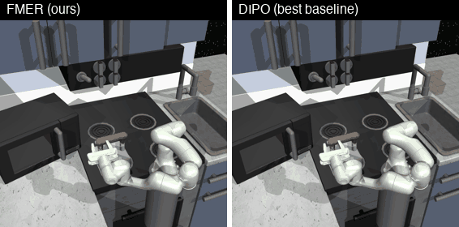

<div align="center">

# FMER

### Flow Matching Policy Optimization with Mirror Descent and Entropy Constraints

[](https://neurips.cc/Conferences/2026)
[](https://www.python.org/)
[](https://github.com/jax-ml/jax)



<sub>FrankaKitchen, 280-step budget. <b>FMER</b> finishes 5 sub-tasks (kettle → bottom burner → light switch → top burner → slide cabinet); the strongest baseline, <b>DIPO</b>, finishes 3.</sub>

</div>

---

## TL;DR

FMER is an online RL algorithm with a **flow matching (ODE) policy** that gets three properties no prior diffusion or flow policy has all at once:

| | Policy Mirror Descent | Entropy Constrained | Unbiased Entropy Objective | Simulation-Free Training |
|:--|:--:|:--:|:--:|:--:|
| DIPO | ❌ | ❌ | ❌ | ✅ |
| DPMD | ✅ | ❌ | ❌ | ✅ |
| QVPO | ❌ | ✅ | ❌ | ✅ |
| SAC-Flow | ❌ | ✅ | ❌ | ❌ |
| FLAME | ❌ | ✅ | ❌ | ❌ |
| **FMER (ours)** | ✅ | ✅ | ✅ | ✅ |

On the sparse-reward **FrankaKitchen** benchmark FMER beats all eight baselines, and the gap widens as the number of tasks grows. It stays competitive on dense-reward **MuJoCo**.

## Method

FMER represents the policy as a velocity field $v_\theta(x_t, t, s)$ in an unbounded latent space and squashes the result into bounded actions with $a = \tanh(x_1)$. Training minimizes one loss:

```math
\mathcal{L}_{\text{FMER}}(\theta) = {\color{#1f77b4}\mathcal{L}_{\text{W-CFM}}(\theta)} + \alpha\,{\color{#2ca02c}\mathcal{L}_{\text{ent}}(\theta)}
```

**1. Mirror descent through weighted flow matching (Thm. 1).** Sample $M$ candidate actions from the current policy, score them with the critic, and weight the conditional flow matching loss by the softmax of their advantages:

```math
{\color{#1f77b4}\mathcal{L}_{\text{W-CFM}} = \mathbb{E}\left[ w(s,a)\,\big\| v_\theta(x_t,t,s) - (\text{arctanh}(a) - x_0) \big\|^2 \right]},
\qquad w(s,a^{(j)}) = \frac{\exp(A(s,a^{(j)})/\tau)}{\sum_l \exp(A(s,a^{(l)})/\tau)}
```

We prove that the global minimizer is exactly the policy mirror descent target $\pi^\ast \propto \pi_k \exp(A/\tau)$. Training is simulation-free, so gradients never pass through the ODE solver.

**2. Closed-form entropy with a tanh correction (Thm. 2, Prop. 1).** The entropy of an ODE policy follows from the divergence of its vector field. We correct for the density distortion that the tanh squashing introduces:

```math
{\color{#2ca02c}\mathcal{L}_{\text{ent}} = -\,\mathbb{E}_{t,x_t}\Big[ \nabla_x \cdot v_\theta(x_t,t,s) \;-\; 2\,\langle \tanh(x_t),\, v_\theta(x_t,t,s) \rangle \Big]}
```

The divergence is estimated with Hutchinson's trace estimator, which costs $\mathcal{O}(d)$. The multiplier $\alpha$ is tuned by dual gradient descent toward a target entropy $\bar H$.

**3. Adaptive trust region via effective sample size.** The temperature $\tau$ is adjusted at every step to hold the effective sample size $\mathrm{ESS} = 1/\sum_l w_l^2$ of the candidate weights at a target $\mathrm{ESS}^\ast$. This removes per-environment temperature tuning.

During interaction, FMER samples $M$ candidates with Euler integration (10 steps) and executes the one with the highest Q-value.

## Results

All methods are trained for 1M environment steps on 5 seeds. Each evaluation runs 10 episodes. We report the mean (std) of the maximum return over the final 10% of training.

### FrankaKitchen: normalized task completion rate (%)

Sparse binary reward, 280 steps per episode. $N$ is the number of sub-tasks in the goal.

| Method | N=1 | N=2 | N=4 | N=7 |
|:--|--:|--:|--:|--:|
| PPO | 2.00 (4.47) | 0.00 (0.00) | 1.00 (2.24) | 8.57 (7.82) |
| SAC | 40.00 (54.77) | 32.00 (24.90) | 2.50 (3.54) | 12.29 (4.24) |
| TD3 | 0.00 (0.00) | 11.00 (24.60) | 15.00 (17.32) | 5.71 (7.82) |
| DIPO | 0.00 (0.00) | 33.00 (30.33) | 14.50 (21.39) | 23.14 (18.36) |
| DPMD | 60.00 (54.77) | **50.00 (0.00)** | 25.00 (17.68) | 20.57 (8.67) |
| QVPO | 0.00 (0.00) | 0.00 (0.00) | 0.00 (0.00) | 18.86 (9.44) |
| SAC-Flow | 0.00 (0.00) | 0.00 (0.00) | 0.00 (0.00) | 0.57 (1.28) |
| FLAME | 8.00 (17.89) | 10.00 (22.36) | 6.50 (14.53) | 18.29 (7.79) |
| **FMER** | **80.00 (44.72)** | 48.00 (4.47) | **46.50 (3.79)** | **40.29 (21.03)** |

### MuJoCo-v5: episode return

| Method | Hopper | HalfCheetah | Walker2d | Humanoid |
|:--|--:|--:|--:|--:|
| PPO | 1198.02 (360.64) | 5982.74 (810.60) | 4598.21 (222.17) | 811.94 (78.20) |
| SAC | 3318.64 (132.80) | 10295.33 (1170.43) | 4441.51 (536.85) | **5326.73 (58.93)** |
| TD3 | **3662.14 (61.58)** | 9496.59 (901.14) | 4887.65 (630.96) | 318.33 (208.02) |
| DIPO | 3408.50 (297.31) | 9516.47 (1417.20) | 5028.66 (217.36) | 5087.46 (100.04) |
| DPMD | 3397.57 (278.06) | 10706.06 (817.59) | 4901.24 (351.59) | 5084.60 (27.90) |
| QVPO | 3422.73 (413.41) | 10309.60 (1398.37) | 4846.39 (397.71) | 5064.21 (48.82) |
| SAC-Flow | 2930.95 (510.33) | 9933.18 (254.50) | 5233.78 (728.87) | 4857.14 (2763.20) |
| FLAME | 2593.95 (432.33) | 10900.69 (1478.33) | 4407.20 (143.72) | 5207.44 (345.98) |
| **FMER** | 2913.45 (642.67) | **12332.38 (903.67)** | **5282.89 (437.57)** | 5286.12 (65.35) |

FMER has the best return on HalfCheetah and Walker2d and the best Humanoid return among generative policies. On Hopper, a simple unimodal task, the entropy constraint keeps FMER exploring longer than the task needs.

### Training cost (Humanoid-v5, 1M steps, single V100)

| DIPO | DPMD | QVPO | SAC-Flow | FLAME | **FMER** |
|--:|--:|--:|--:|--:|--:|
| 294 min | 276 min | 19.7 h | 126 min | 11.5 h | **215 min** |

## Getting started

### Installation

Requirements: Linux with an NVIDIA GPU (CUDA 12). The pinned `jax[cuda12]` wheels are Linux-only. The project uses [uv](https://docs.astral.sh/uv/) and Python 3.13.

```bash
git clone https://github.com/gtanaelle/FMER.git
cd FMER
uv sync
```

### Training

Each run reads its configuration from `configs/<alg>/<env>.toml`:

```bash
# FMER on Walker2d, seed 0
uv run python scripts/train_mujoco.py --alg fmer --env walker2d --seed 0

# FMER on FrankaKitchen (all 7 tasks); use frankakitchen_1 / _2 / _4 for N = 1, 2, 4
uv run python scripts/train_mujoco.py --alg fmer --env frankakitchen --seed 0
```

Available environments: `hopper`, `halfcheetah`, `walker2d`, `humanoid`, `frankakitchen`, `frankakitchen_1`, `frankakitchen_2`, `frankakitchen_4`.
The baselines included in this repo (`dipo`, `dpmd`, `qvpo`, `fpo`) run with the same command. Not every baseline has a config for every environment; for `dpmd` and `qvpo`, Walker2d is `--env walker`.

Logs, checkpoints and `evaluation.csv` (evaluated every 10K steps) are written to `exp_logs/test/<env>/<run_name>/`.

All configs ship with `use_wandb = true`, so run `uv run wandb login` first, or set `use_wandb = false` in the `[logging]` section of the config to train without W&B.

### Sweeps with Weights & Biases

```bash
uv run wandb sweep weep_config.yaml     # creates a sweep over envs x seeds
uv run wandb agent <entity/project/sweep_id>
```

The sweep grid (environments × seeds 0–4) is defined in `weep_config.yaml`. Each run logs to the `wandb_project` set in its config.

## Repository structure

```
configs/        per-algorithm, per-environment TOML configs
relax/
  algorithm/    FMER and baseline algorithms (fmer.py, dipo.py, dpmd.py, qvpo.py, fpo.py)
  network/      policy and critic networks
  utils/FM.py   flow matching utilities
  trainer/      off-/on-policy trainers and evaluator
  env/ buffer/  vectorized environments and replay buffers
scripts/        training entry point, result collection and plotting
```

## Citation

```bibtex
@inproceedings{fmer2026,
  title     = {Flow Matching Policy Optimization with Mirror Descent and Entropy Constraints},
  author    = {Gao, Ting and others},
  booktitle = {Advances in Neural Information Processing Systems},
  year      = {2026}
}
```

